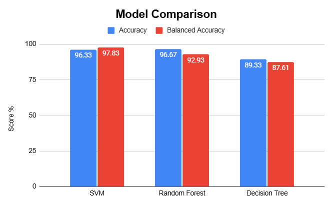

# Intelligent Rehabilitation System: EMG-Based Muscle Activation Classification

## Overview

This project investigates whether machine-learning models can classify VMO- and VL-dominant muscle activation patterns using surface electromyography (sEMG) features recorded during squatting.

The project processes two-channel EMG signals, extracts temporal, amplitude, and synchronization features, and evaluates three machine-learning classifiers:

- Random Forest
- Support Vector Machine (SVM)
- Decision Tree

## Research Question

How effectively can machine-learning models classify VMO- and VL-dominant muscle activation patterns from surface electromyography (EMG) features during squatting, and which evaluated model achieves the highest classification performance?

## Project Pipeline

Raw EMG data  
↓  
Signal preprocessing  
↓  
Windowing  
↓  
Feature extraction  
↓  
Feature selection  
↓  
Feature scaling  
↓  
Machine-learning classification  
↓  
Model evaluation

## Dataset

The project uses a publicly available two-channel surface electromyography dataset associated with squatting.

The processed dataset contains 998 observations:

- 157 VMO-dominant observations
- 841 VL-dominant observations

No new human-subject data were collected for this project.

## Feature Extraction

The feature-extraction stage initially generated seven candidate features.

Two ratio-based features were subsequently removed from the final machine-learning models:

- RMS ratio
- iEMG ratio

The final models therefore used five features:

1. VMO activation (RMS)
2. VL activation (RMS)
3. Peak activation delay
4. Muscle onset delay
5. Muscle synchronization

These features represent three broad aspects of muscle activation:

- **Activation magnitude:** VMO and VL RMS
- **Temporal coordination:** peak and onset delays
- **Synchronization:** inter-channel correlation

## Machine-Learning Models

Three classification models were evaluated:

### Random Forest

An ensemble classifier consisting of multiple decision trees.

### Support Vector Machine

An SVM with an RBF kernel was used for nonlinear classification.

### Decision Tree

A single decision-tree classifier was evaluated as a comparatively interpretable baseline.

## Results

The three classifiers were evaluated using accuracy and balanced accuracy.

| Model | Accuracy | Balanced Accuracy |
|---|---:|---:|
| Random Forest | 96.67% | 92.83% |
| Support Vector Machine (SVM) | 96.33% | 97.83% |
| Decision Tree | 89.33% | 87.61% |

The Random Forest achieved the highest overall accuracy, while the SVM achieved the highest balanced accuracy among the evaluated models.

##Key Findings

- **Random Forest:** 96.67% accuracy; 92.83% balanced accuracy.
- **Support Vector Machine (SVM):** 96.33% accuracy; 97.83% balanced accuracy.
- **Decision Tree:** 89.33% accuracy; 87.61% balanced accuracy.

The SVM achieved the highest balanced accuracy among the three models. However, these preliminary results should be interpreted cautiously because the labels were derived from RMS-based thresholds, and overlapping signal windows may introduce data leakage between training and testing sets.

This project demonstrates a preliminary machine-learning workflow for analysing surface EMG features. It is not a clinically validated rehabilitation or diagnostic system.

These results are preliminary. The evaluation used a random window-level train/test split, and overlapping windows may share similar signal information across both sets. Furthermore, the activity labels were generated using an RMS-ratio threshold, so the models may partly learn the rule used to assign those labels.

Consequently, these metrics should not be interpreted as evidence of generalisation to unseen participants or clinically validated muscle-imbalance detection.


 
## Class Imbalance

The dataset contains substantially more VL-dominant observations than VMO-dominant observations.

Because of this imbalance, accuracy alone does not provide a complete assessment of model performance. Balanced accuracy and class-specific metrics were therefore also considered.

## Limitations and Future Improvements

- **Label generation:** The classification labels were derived using RMS-based thresholds, so the models may learn the rules used to create the labels rather than independent patterns of muscle activity.
- **Potential data leakage:** Overlapping signal windows may create similarities between training and testing samples, potentially inflating performance estimates.
- **Dataset limitations:** The processed dataset does not retain participant-level identifiers, preventing participant-independent evaluation.
- **Future work:** Evaluate models using participant-independent splits, investigate alternative feature sets, and validate the approach on additional EMG recordings.

The current results are preliminary and do not establish clinical effectiveness.

## Future Work

Potential extensions include:

- repeated stratified cross-validation
- subject- or trial-wise validation
- evaluation using an independent dataset
- improved onset-detection methods
- model explainability
- real-time EMG classification

## Reproducibility

The notebooks in this repository document the preprocessing, feature extraction, model training, and evaluation stages of the project.

The notebooks should be executed in numerical order.

## Research Paper

The associated research paper is available in the paper/ directory.

## Disclaimer

This project is a research prototype and is not intended for clinical diagnosis or medical decision-making.
## Repository Structure

```text
## Repository Structure

```text
intelligent-rehab-emg/
├── data/
│   └── README.md
├── notebooks/
│   ├── 01_initial_processing.ipynb
│   ├── 02_VMO_VL_exploration.ipynb
│   ├── 03_Channel_analysis.ipynb
│   ├── 04_feature_extraction.ipynb
│   ├── 05_svm.ipynb
│   ├── 06_Random_Forest.ipynb
│   └── 07_Decision_Tree.ipynb
├── paper/
│   └── manuscript.pdf
│
└── results/
│   └── Model_Comparison.png
│   └── README.md
│   └── decision_tree_confusion_matrix.png
│   └── random_forest_confusion_matrix.png
│   └── svm_confusion_matrix.png
├── .gitignore
├── README.md
└── requirements.txt

